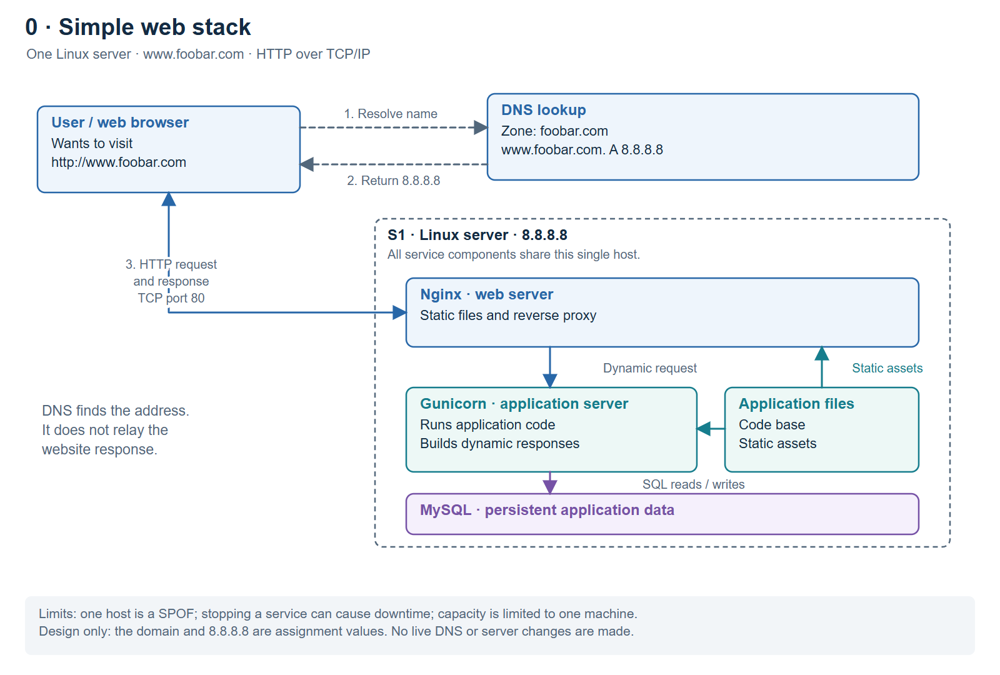

# 0. Simple web stack

## Explain the request

A user enters `http://www.foobar.com`. The browser obtains `8.8.8.8` from DNS
and connects to the server on TCP port 80. Nginx serves static content or
forwards a dynamic request to Gunicorn. Gunicorn executes the application code,
queries MySQL when needed, and returns a result through Nginx to the browser.

## Explain the components

| Component | Role in this design |
| --- | --- |
| Server | One Linux physical machine or virtual machine providing CPU, memory, storage and networking for all the services. A server can also mean the service software, but the outer box is the host. |
| Domain name | `foobar.com` provides a readable namespace. The requested hostname is `www.foobar.com`, so the user need not remember an IP address. |
| DNS record | The `www` label has an **A record** with value `8.8.8.8`. `www` itself does not inherently imply any particular record type. |
| Nginx web server | Receives HTTP requests, serves static files and proxies dynamic requests to the application server. |
| Gunicorn application server | Runs the application's Python code and returns dynamic responses. |
| Application files | The source code and static assets used by the services. Files are not another server. |
| MySQL database | Stores structured application data persistently and answers SQL reads and writes. |

The server and user's computer exchange HTTP messages over TCP/IP. DNS lookup
is a separate step. The drawing uses HTTP, so this first design does not encrypt
the website traffic.

## Explain the limitations

- **SPOF:** if the single host fails, the entire site fails. Failure of a required
  process such as MySQL can also interrupt the corresponding functionality.
- **Maintenance downtime:** a host reboot or a stop/start deployment can leave
  no healthy instance to serve traffic. Nginx supports graceful reloads, so not
  every configuration change requires downtime; the problem is the absence of
  a spare instance when a service really must stop.
- **Limited scale:** web, application and database work compete for one host's
  resources. A larger host may help temporarily, but this design has no second
  server to share increasing traffic.

Sources: [DNS A records](https://www.cloudflare.com/learning/dns/dns-records/dns-a-record/),
[Nginx serving, proxying and reloading](https://nginx.org/en/docs/beginners_guide.html).
