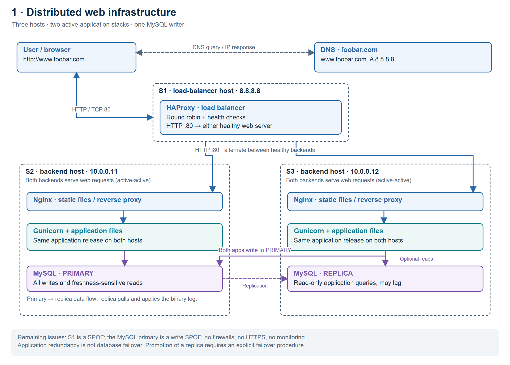

# 1. Distributed web infrastructure

## Inventory and additions

The total is **three hosts**. S1 runs HAProxy; S2 and S3 each run Nginx,
Gunicorn, the application files and a MySQL instance. DNS now directs the
browser to HAProxy's public address. The backends use private addresses.

| Addition relative to task 0 | Why it is added |
| --- | --- |
| Load-balancer host and HAProxy | Provide a common entry point, select a healthy backend and distribute traffic. |
| Second backend host | Supplies additional capacity and another web/application instance during a failure or maintenance. |
| Second Nginx instance | Lets either backend receive and serve web traffic. |
| Second application server and copy of the code | Let both backends produce the same application responses. Keep their releases consistent. |
| Second MySQL instance | Maintains a replica and can serve selected reads. |

## Traffic and balancing

HAProxy is explicitly configured with `balance roundrobin`, equal server
weights and health checks. It sends successive eligible requests to successive
healthy servers. This is a design choice, not an assumption about a version's
default algorithm. The two application stacks are **active-active**: both
normally serve traffic. In active-passive operation, a spare would receive
traffic only after the active member fails.

There is still only one load balancer; it is not a redundant HAProxy cluster.
The application is assumed to be stateless between requests, with durable
state in MySQL, rather than relying on sessions stored only in one process.

## Primary and replica

S2's MySQL primary accepts all application writes. Its binary log records
changes; S3's replica retrieves the log and applies those changes. Replication
is asynchronous in this design, so the replica can lag.

Both application servers send writes and freshness-sensitive reads to the
primary. S3 can use the replica for reads that tolerate stale data. Application
credentials do not permit writes on the replica. The replication arrow shows
the direction in which data changes propagate, not who initiates the connection.

A replica is not an automatic replacement for the primary. A safe promotion
procedure must prevent the old primary from continuing to accept writes and
must update the applications' database endpoint.

## Remaining problems

- **SPOFs:** HAProxy is the sole entry point; the primary is the only writer.
  Its host also runs one application stack, so that host's failure affects both.
- **Security:** this stage has no configured host firewalls and uses unencrypted
  HTTP. It has no HTTPS certificate.
- **No monitoring:** there is no central visibility into latency, error rates,
  resource saturation or replication lag. HAProxy health checks alone are not
  a full monitoring system.

Sources: [HAProxy balancing](https://www.haproxy.com/documentation/haproxy-configuration-tutorials/proxying-essentials/configuration-basics/backends/),
[MySQL replication implementation](https://dev.mysql.com/doc/refman/8.0/en/replication-implementation.html).
