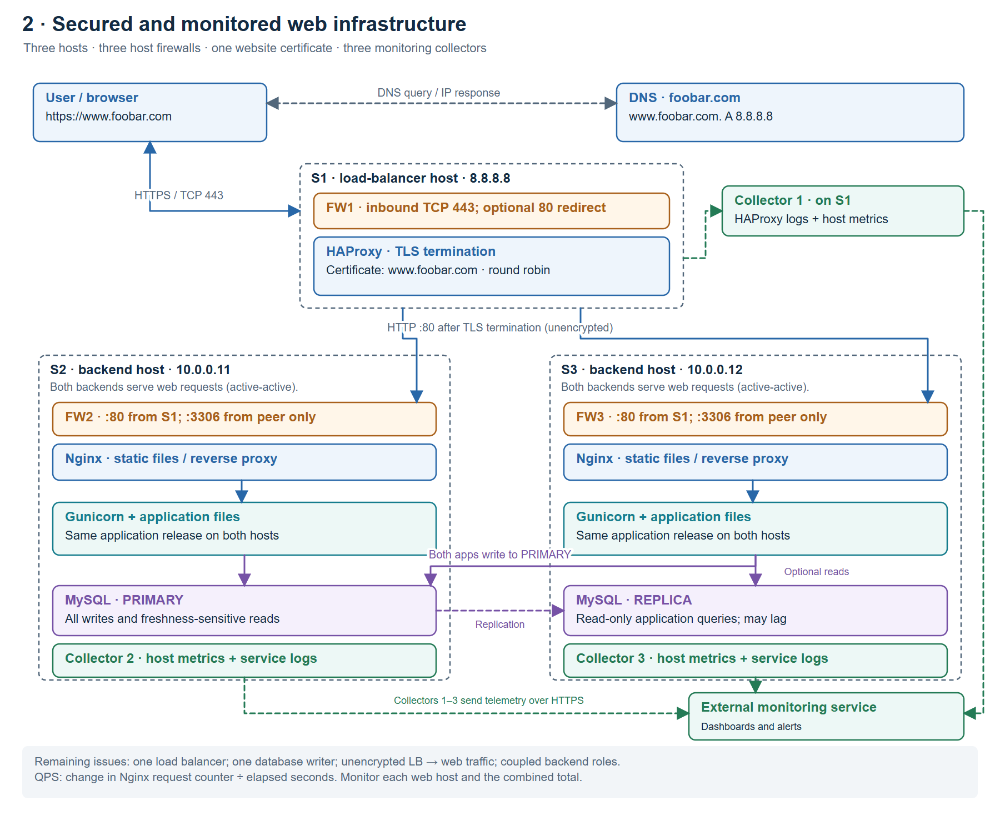

# 2. Secured and monitored web infrastructure



The three-host layout from task 1 remains. The additions are **three host
firewalls**, **one website certificate**, and **three installed monitoring
collectors**, one on each host. The monitoring service is external.

## Security additions

| Addition | Purpose and policy |
| --- | --- |
| FW1 on S1 | Allow public HTTPS on TCP 443; optionally allow TCP 80 only to redirect to HTTPS. Restrict administration to a trusted management source. |
| FW2 on S2 | Accept web traffic on TCP 80 only from S1. Permit necessary MySQL traffic on TCP 3306 from S3; local application traffic stays local. |
| FW3 on S3 | Accept web traffic on TCP 80 only from S1. Permit authorized MySQL traffic on TCP 3306 from S2. |
| TLS certificate on HAProxy | Identify `www.foobar.com` and enable HTTPS between the browser and HAProxy. |

The firewalls filter connections by rules such as source, destination, protocol
and port; they do not repair application vulnerabilities. Deny unsolicited
inbound traffic by default, allow established responses, and allow required
outbound DNS and HTTPS telemetry. Never expose MySQL directly to the Internet.

HTTPS protects the browser-to-HAProxy connection against eavesdropping and
tampering and, with a trusted certificate, authenticates the hostname. SSL is
the older term used by the assignment; TLS is the modern protocol.

## Monitoring additions

Each host runs a Sumo Logic installed collector. It reads configured log and
metric sources and sends data over HTTPS to the external monitoring service.
Collector 1 reports on HAProxy and S1; collectors 2 and 3 report on their host,
Nginx, the application and MySQL. Dashboards and alerts help detect failures,
high latency, HTTP errors, resource saturation and replication lag.

To monitor web QPS, sample Nginx's cumulative `requests` counter through a
restricted `stub_status` endpoint. Compute:

```text
QPS = (requests_now - requests_previous) / elapsed_seconds
```

Handle counter resets after restarts, graph each web server, and sum the two
rates for the web tier. Requests are not the same as open connections. Set
alerts relative to tested capacity and error/latency targets. The collector
can run a configured script source to collect the counter; it does not discover
this metric automatically.

## Remaining problems to explain

- **TLS termination:** the drawing encrypts the browser-to-HAProxy leg but uses
  plain HTTP from HAProxy to Nginx. Anyone able to observe that internal traffic
  can read it. Re-encrypting and verifying backend TLS, or using TLS passthrough
  where appropriate, addresses this boundary. Termination itself is not
  inherently insecure if subsequent hops are protected.
- **One database writer:** writes still depend on one MySQL primary. A replica
  adds a copy and read capacity, not automatic write availability.
- **Mixed roles:** web, application and database processes compete for resources,
  share failure and security boundaries, and cannot be scaled independently.
- **One load balancer:** HAProxy's host remains a SPOF despite firewalls and
  monitoring. Monitoring detects a problem; it does not itself remove it.

Sources: [firewalls](https://www.cloudflare.com/learning/security/what-is-a-firewall/),
[HTTPS](https://developer.mozilla.org/en-US/docs/Glossary/HTTPS),
[HAProxy TLS](https://www.haproxy.com/documentation/haproxy-configuration-tutorials/security/ssl-tls/basics-enable-tls/),
[installed collectors](https://www.sumologic.com/help/docs/send-data/installed-collectors/),
[Nginx request counter](https://nginx.org/en/docs/http/ngx_http_stub_status_module.html).
