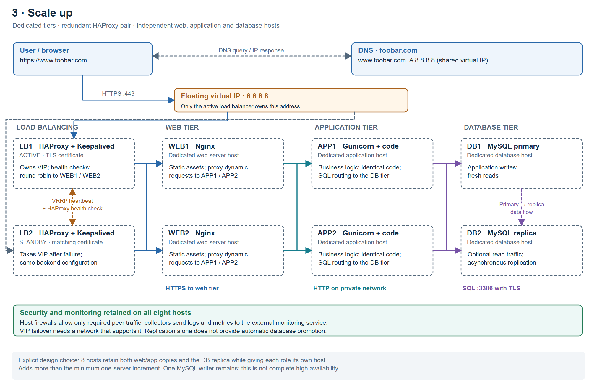

# 3. Scale up

## Scope and host count

The researched task asks for another server, a second HAProxy clustered with
the first, and separate hosts for the web, application and database roles.
This design goes beyond the minimum server addition: it uses **eight hosts**
to keep the two web/application copies and the database replica while separating
every role. It does not claim that these roles fit on only four hosts.

| Tier | Hosts | Why these hosts are present |
| --- | --- | --- |
| Load balancing | LB1, LB2 | A second HAProxy host supplies a standby entry point if the first host or HAProxy service fails. |
| Web | WEB1, WEB2 | Dedicated Nginx hosts isolate static serving and proxy work; two copies retain web capacity during maintenance or a failure. |
| Application | APP1, APP2 | Dedicated Gunicorn hosts run identical code, isolate application CPU/memory use and let application capacity grow independently. |
| Database | DB1 primary, DB2 replica | Separate MySQL hosts isolate storage and database resources while retaining a replica and optional read capacity. |

The service separation adds hosts beyond the second load balancer. Each
host has one workload role, plus the firewall and monitoring collector.

## Explain the load-balancer cluster

DNS points to the shared virtual IP, not to two unrelated addresses.
Keepalived/VRRP manages an **active-passive** pair: LB1 owns the VIP normally,
and LB2 can take it after failure detection. Health checks must cover the
HAProxy process as well as the host. Both members have matching routing
configuration and the website certificate.

This assumes a network that permits VIP movement and VRRP. A platform that
does not support them needs its own supported failover mechanism. HAProxy
alone does not move an IP address. Existing connections may break during
failover and need client retries.

## Follow a request through the tiers

1. The browser resolves the name and connects over HTTPS to the VIP.
2. The active HAProxy selects a healthy Nginx host using round robin. This hop
   uses verified backend HTTPS, improving the plaintext hop from task 2.
3. Nginx serves static assets or proxies a dynamic request to either healthy
   application host. This example uses HTTP on that restricted private hop;
   it is not end-to-end TLS across every service.
4. The application uses TLS-protected SQL connections: writes and fresh reads
   go to DB1; selected stale-tolerant reads can go to DB2.
5. The response returns through the same service path to the browser.

Both web instances and both application instances serve requests actively.
The application remains stateless between requests. Host firewalls restrict
each tier to its intended peers, and collectors report to the monitoring service.

## What this improves, and what remains

Role separation reduces resource contention and lets each tier be scaled or
maintained independently. A second load balancer removes the single-host entry
point under the stated failover assumptions. Rolling maintenance can remove
one healthy web/app node from rotation while its peer continues serving traffic.

The database still has only one writer. Replication lag, safe promotion,
backups and restore procedures still matter. Shared network or site failures
can also affect multiple hosts. This is improved redundancy, not a claim that
every possible SPOF has disappeared.

Sources: [HAProxy balancing](https://www.haproxy.com/documentation/haproxy-configuration-tutorials/proxying-essentials/configuration-basics/backends/),
[HAProxy client and backend TLS](https://www.haproxy.com/documentation/haproxy-configuration-tutorials/security/ssl-tls/basics-enable-tls/),
[HAProxy VRRP clustering overview](https://cdn.haproxy.com/assets/content-library/datasheets/haproxy-enterprise.pdf).
